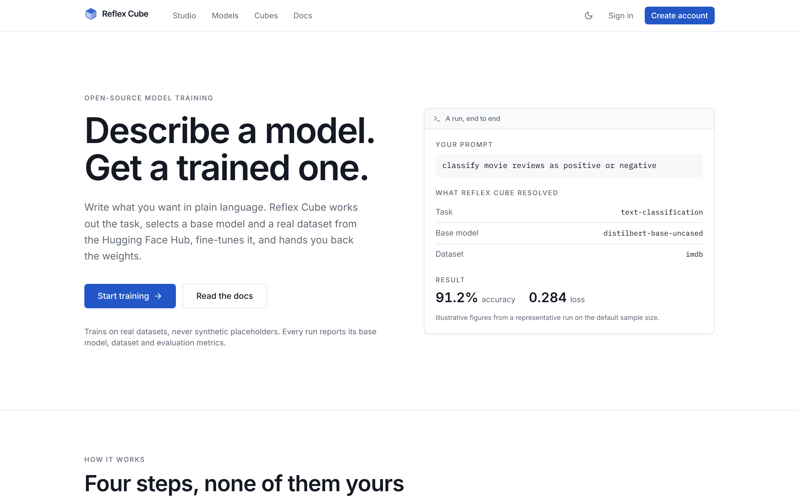
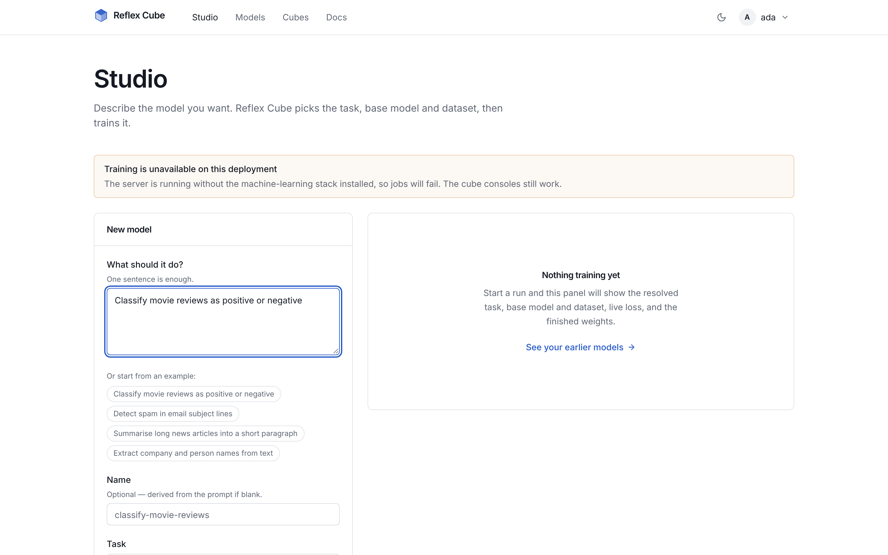
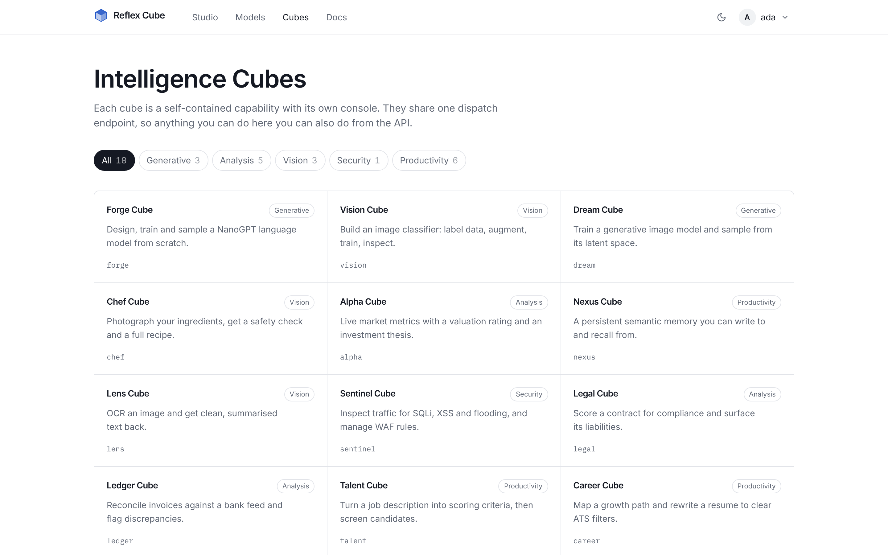
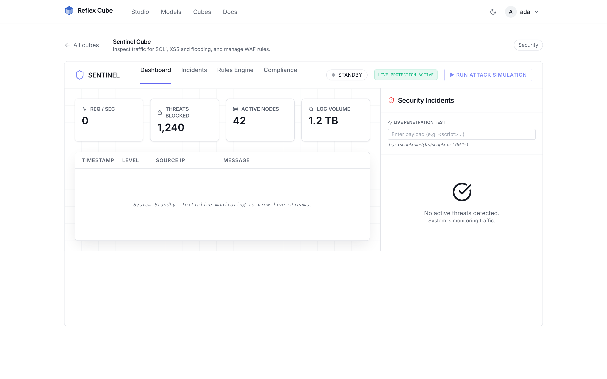
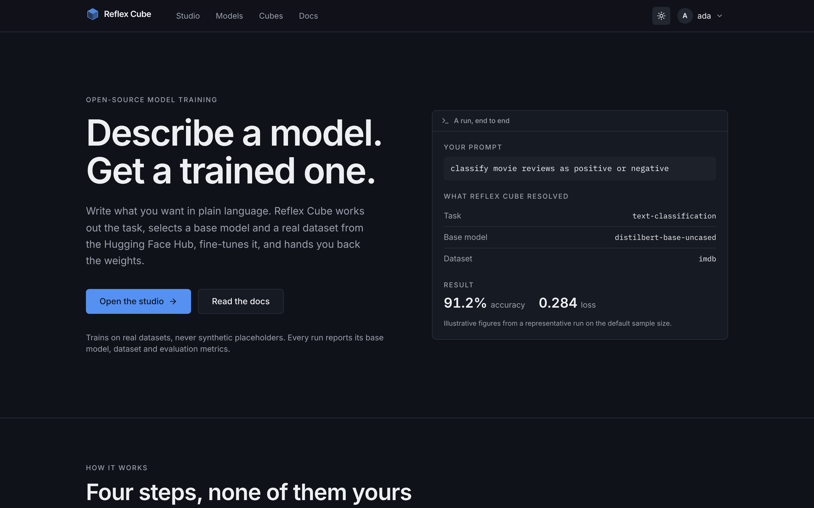
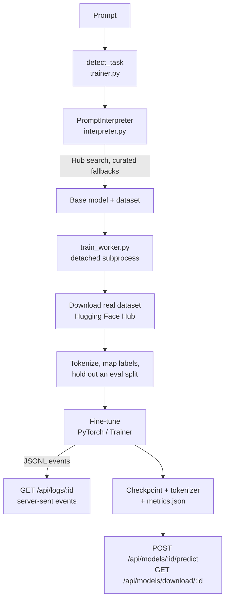
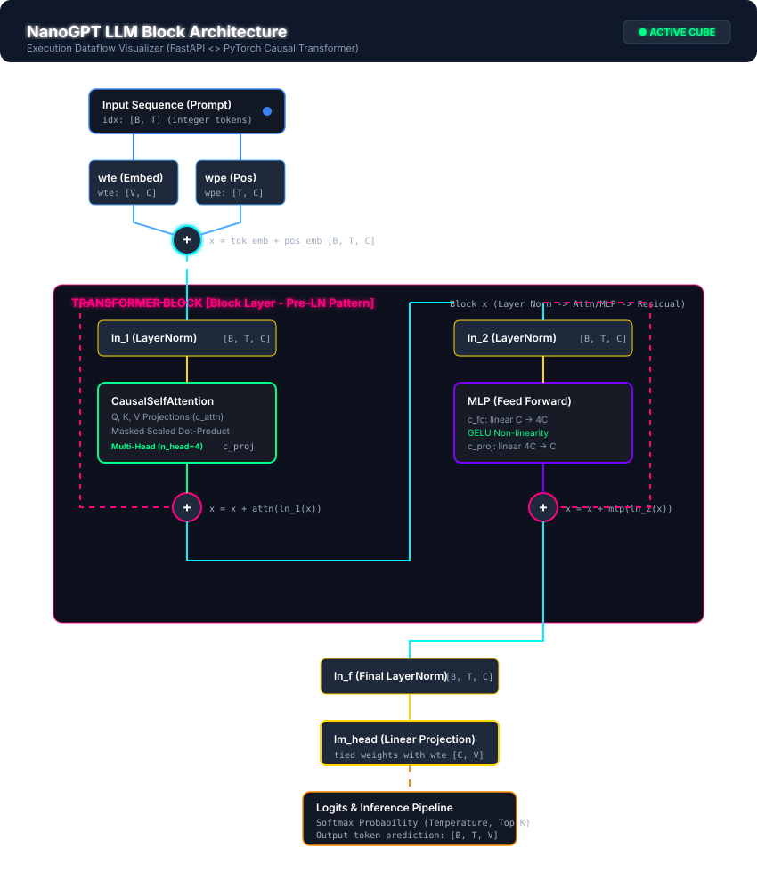

<h1 align="center">🧊 Reflex Cube</h1>
<p align="center"><strong>Prompt-driven model generation, and a registry of task-specific AI cubes.</strong></p>

<p align="center">
  
  
  
  
  
  
  
</p>



> **Run it online, free.** The whole stack deploys at no cost: the API on
> Hugging Face Spaces, Postgres on Neon, trained models on the Hugging Face
> Hub, the client on Vercel. See **[docs/hosting.md](docs/hosting.md)**.

---

## What it is

Reflex Cube does two things.

**It turns a prompt into a trained model.** You describe what you want —
*"build a sentiment analysis model for movie reviews"* — and the backend infers
the task, picks a base model and a real dataset from the Hugging Face Hub,
fine-tunes in a background process, and streams epoch and loss back to the
browser while it runs. The result is a downloadable checkpoint you can run
inference against from the dashboard.

**It runs a registry of Intelligence Cubes.** Each cube is a self-contained
capability — contract review, forensic invoice audit, OCR, image
classification, WAF simulation — behind one dispatch endpoint and its own
console in the web app.

| | |
|:---:|:---:|
|  |  |
| *The studio — describe a model, watch it train* | *The cube registry* |
|  |  |
| *A cube console* | *Dark theme* |

---

## Quick start

**Requirements:** Python 3.10+, Node 20.19+, and `make` (optional but assumed
below).

```bash
git clone https://github.com/kh-bikash/Reflex-Cube.git
cd Reflex-Cube

make setup     # backend venv + frontend node_modules
make dev       # API on :8000, web client on :8080
```

Open <http://localhost:8080>. The API's interactive docs are at
<http://localhost:8000/docs>.

`make setup` installs the **core** backend, which starts in seconds and gives
you the full API, the cube catalog, job tracking, log streaming and nine of the
sixteen cubes. Training and the model-backed cubes need the ML stack:

```bash
make setup-backend-ml      # torch, transformers, datasets, … (several GB)
```

Run `make env` at any point to see which optional packages and credentials are
present, and which cubes can load as a result.

<details>
<summary>Without <code>make</code></summary>

```bash
# Backend
cd backend
python -m venv .venv
source .venv/bin/activate            # Windows: .venv\Scripts\activate
pip install -r requirements.txt      # or requirements-ml.txt for training
uvicorn app.api:app --reload --port 8000

# Frontend, in a second terminal
cd frontend
npm ci
npm run dev
```

</details>

<details>
<summary>With Docker</summary>

```bash
docker compose up --build            # API :8000, web client :8080
```

The default backend image is API-only so it builds quickly. For training:

```bash
INSTALL_ML=true docker compose up --build
```

</details>

---

## How prompt-to-model works



1. **Task resolution** — `detect_task` honours an explicit task, otherwise it
   reads the prompt. Everything maps onto a canonical Hugging Face task name.
2. **Model and dataset** — `PromptInterpreter` searches the Hub for a dataset
   matching the prompt's content words, filtered by task and sorted by
   downloads. When the search finds nothing loadable it falls back to a
   curated corpus for the prompt's domain (`imdb` for reviews, `banking77` for
   finance, `conll2003` for entities, …). Base models default to small
   architectures that fine-tune in minutes on CPU, unless the prompt names one.
3. **Training out of process** — the job runs in a detached subprocess, so a
   CPU-bound fine-tune never blocks the event loop. Progress is appended as
   JSONL and mirrored into the job row.
4. **Live progress** — `GET /api/logs/{job_id}` tails that file as server-sent
   events and closes when the job reaches a terminal state.
5. **Results** — the checkpoint, tokenizer and `metrics.json` are saved under
   `STORAGE_PATH/<job_id>/`, ready for inference or download as a zip.

Datasets are always real downloads from the Hub. A job that cannot fetch one
fails with the reason rather than quietly training on synthetic data.

> **Sample caps.** Hub corpora run to millions of rows and an uncapped CPU
> fine-tune never finishes, so jobs use `MAX_TRAIN_SAMPLES` (default 2,000)
> rows, shuffled before slicing. Raise it, or set it to `0` for no cap, in
> `backend/.env`.

---

## The Forge: training an LLM from scratch

The Forge cube is a sandbox for building a small causal language model
(NanoGPT) end to end — architecture, training loop, sampling — rather than
fine-tuning someone else's.



The implementation lives in
[`backend/app/cubes/forge_core/model.py`](backend/app/cubes/forge_core/model.py):

- **`CausalSelfAttention`** — projects to Q, K and V, splits across heads, and
  masks with a triangular buffer so a position cannot attend to its future.
- **`MLP`** — expands `C → 4C`, applies GELU, projects back to `C`.
- **`Block`** — pre-layer-norm, with residual paths around both the attention
  and the feed-forward sublayers.
- **`NanoGPT`** — token and positional embeddings, with the embedding matrix
  tied to the language-modelling head.

---

## The Intelligence Cubes

Every cube implements one interface and is reachable at `POST /api/cubes/run`
with `{"cube_id": "...", "input": {...}}`. The registry imports each cube
lazily, so one missing optional dependency marks only that cube unavailable —
`GET /api/health` and `make env` report which.

| Cube | Does | Needs |
| :--- | :--- | :--- |
| 🔨 **Forge** | Design, train and sample a NanoGPT from scratch | torch, tiktoken |
| 👁️ **Vision** | Label an image dataset, augment it, train a classifier, inspect it | torch, torchvision, Pillow |
| 💭 **Dream** | Train a small diffusion model and sample from a prompt | torch, torchvision, Pillow |
| 🍳 **Chef** | Read ingredients from a photo, return a safety check and a recipe | torch, transformers, Pillow |
| 📈 **Alpha** | Live market metrics, a valuation rating and an investment thesis | yfinance |
| 🔗 **Nexus** | Persistent semantic memory you can write to and recall from | torch, transformers |
| 🔍 **Lens** | OCR an image and return clean, summarised text | torch, easyocr |
| 🛡️ **Sentinel** | Detect SQLi, XSS and flooding; manage WAF rules | core only |
| ⚖️ **Legal** | Score a contract for compliance and surface liabilities | core (pypdf for PDFs) |
| 📓 **Ledger** | Reconcile invoices against a bank feed, flag discrepancies | core only |
| 🧑‍💼 **Talent** | Derive scoring criteria from a job description, screen CVs | core only |
| 💼 **Career** | Map a growth path; rewrite a resume for ATS filters | core (pypdf for PDFs) |
| 🏷️ **Brand** | Naming, copy and identity guidelines | core only |
| 🏋️ **FitPal** | Training plans from biometrics and goals | core only |
| ✈️ **Travel** | Itineraries with budget, weather and day-by-day routing | core only |
| 📜 **Legacy** | Capture and query long-form personal history | core only |

Two further consoles — **Research** and **Social** — have no Python module.
They take a free-text prompt and are served by the ReflexBrain agent loop,
which reasons, optionally executes its own Python in an
[E2B](https://e2b.dev) sandbox to search and scrape, and returns a markdown
report.

Adding a cube is two files and a registry entry — see
[CONTRIBUTING.md](CONTRIBUTING.md#adding-a-cube).

---

## API

Full interactive reference at `/docs` once the server is running, and a written
one in [docs/api.md](docs/api.md). The essentials:

| Method | Path | Purpose |
| :--- | :--- | :--- |
| `POST` | `/api/auth/register` | Create an account → `{access_token, user}` |
| `POST` | `/api/auth/login` | Sign in → `{access_token, user}` |
| `GET` | `/api/auth/me` | The signed-in account |
| `PATCH` | `/api/auth/me` | Change the name, password or Hub token |
| `GET` | `/api/health` | Status, version, database, cubes, capabilities |
| `POST` | `/api/models/create` | Queue a prompt for training → `{job_id}` |
| `GET` | `/api/training/status/{job_id}` | Progress, epoch, loss, accuracy |
| `GET` | `/api/logs/{job_id}` | Live training log (server-sent events) |
| `GET` | `/api/models/all` | Every job, newest first |
| `POST` | `/api/models/{job_id}/predict` | Inference against a trained model |
| `GET` | `/api/models/download/{job_id}` | Checkpoint as a zip archive |
| `DELETE` | `/api/models/{job_id}` | Delete a job and its artefacts |
| `GET` | `/api/cubes` | The cube catalog |
| `POST` | `/api/cubes/run` | Dispatch to a cube |
| `POST` | `/api/cubes/pdf` | Render a markdown report to PDF |

More recipes, and a script that runs a downloaded checkpoint, are in
[examples/](examples/).

Everything that spends CPU needs an account:

```bash
# Sign in
TOKEN=$(curl -sS -X POST localhost:8000/api/auth/login \
  -H 'Content-Type: application/json' \
  -d '{"email":"you@example.com","password":"your-password"}' \
  | python -c 'import json,sys; print(json.load(sys.stdin)["access_token"])')

# Queue a model
curl -X POST localhost:8000/api/models/create \
  -H "Authorization: Bearer $TOKEN" -H 'Content-Type: application/json' \
  -d '{"name":"review-sentiment","prompt":"classify movie reviews as positive or negative"}'

# Watch it train
curl -N -H "Authorization: Bearer $TOKEN" localhost:8000/api/logs/<job_id>

# Run a cube
curl -X POST localhost:8000/api/cubes/run \
  -H "Authorization: Bearer $TOKEN" -H 'Content-Type: application/json' \
  -d '{"cube_id":"alpha","input":{"text":"AAPL"}}'
```

---

## Layout

```text
Reflex-Cube/
├── backend/
│   ├── app/
│   │   ├── api.py            # Application factory and lifespan
│   │   ├── routes/           # models · cubes · logs · system
│   │   ├── cubes/            # The 16 cube implementations + registry
│   │   ├── trainer.py        # Prompt-to-model pipeline
│   │   ├── interpreter.py    # Prompt → base model + dataset
│   │   ├── brain.py          # ReflexBrain agent loop (lazy-loaded)
│   │   ├── config.py         # Env-driven settings; the only source of paths
│   │   ├── db.py · models.py · schemas.py
│   │   └── utils/            # Path helpers and the AI provider router
│   ├── scripts/              # check_env · reset_db · cancel_jobs
│   ├── tests/                # 216 pytest tests
│   └── train_worker.py       # Detached training process
├── frontend/
│   └── src/
│       ├── components/cubes/ # One console per cube
│       ├── pages/            # Route targets
│       └── lib/
│           ├── api.ts        # Typed backend client
│           └── cubes.ts      # Cube catalog (ids must match the backend)
├── docs/                     # Architecture, API, deployment
├── examples/                 # Run a downloaded model; curl recipes
└── docker-compose.yml        # Full stack: API + nginx-served client
```

---

## Configuration

Everything is environment-driven with working defaults; see
[`backend/.env.example`](backend/.env.example) and
[`frontend/.env.example`](frontend/.env.example) for the full list. The ones
you are most likely to touch:

| Variable | Default | Purpose |
| :--- | :--- | :--- |
| `JWT_SECRET` | generated | **Required in any deployment.** Signs sessions; must be ≥32 bytes |
| `DATABASE_URL` | `sqlite:///backend/reflex.db` | Accounts and jobs. Use hosted Postgres anywhere real |
| `CORS_ORIGINS` | `localhost:8080`, `localhost:5173` | Browser origins allowed to call the API |
| `REFLEX_DATA_DIR` | `./storage` | Root for checkpoints, logs and caches |
| `PUBLISH_MODELS_TO_HUB` | `0` | Push finished models to the Hub so they outlive the container |
| `HF_TOKEN` | — | A *write* token: enables publishing, and gated models |
| `MAX_TRAIN_SAMPLES` | `2000` | Training rows per job; `0` for no cap |
| `MAX_MODEL_PARAMETERS` | `200000000` | Refuse a model too large for the instance, with a reason |
| `REQUIRE_AUTH` | `1` | Turn off only for a single-user local install |
| `E2B_API_KEY` | — | Enables the agent's code sandbox |

---

## Development

```bash
make check      # ruff + ESLint + tsc + pytest — the same checks CI runs
make format     # autofix both sides
make test       # pytest with coverage
make env        # what's installed, what's configured, which cubes can load
```

CI runs the backend suite (263 tests) on Linux, macOS and Windows, builds both
Docker images, and gates on `npm audit`. See
[CONTRIBUTING.md](CONTRIBUTING.md) for conventions, and
[docs/architecture.md](docs/architecture.md) for how the pieces fit together.

## Security

Accounts are required by default, and every job belongs to the user who created
it. [SECURITY.md](SECURITY.md) covers what else the platform exposes — the
agent's code sandbox, third-party model downloads — and how to report a
vulnerability.

## Licence

[MIT](LICENSE).
